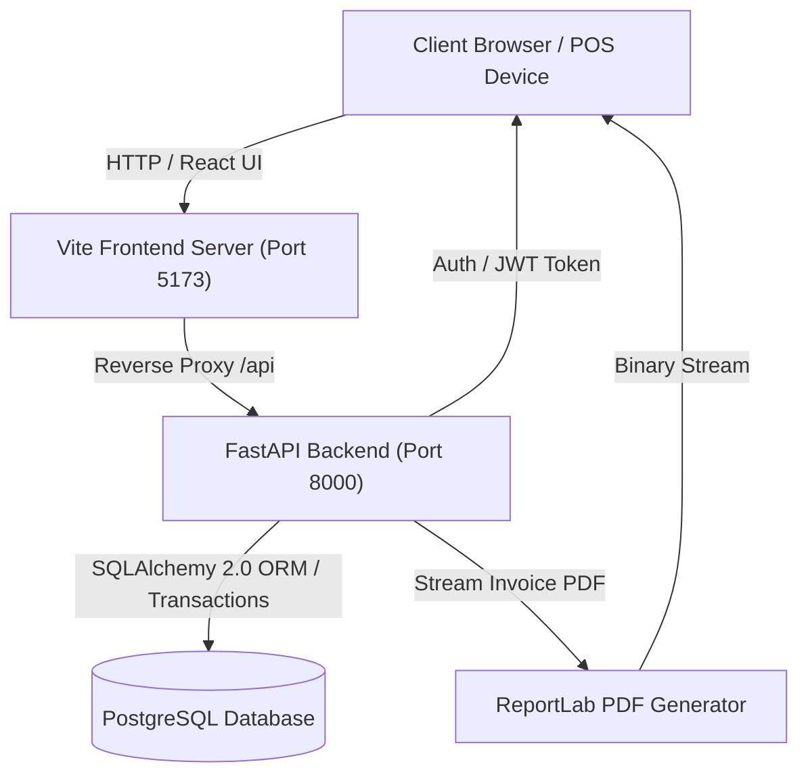
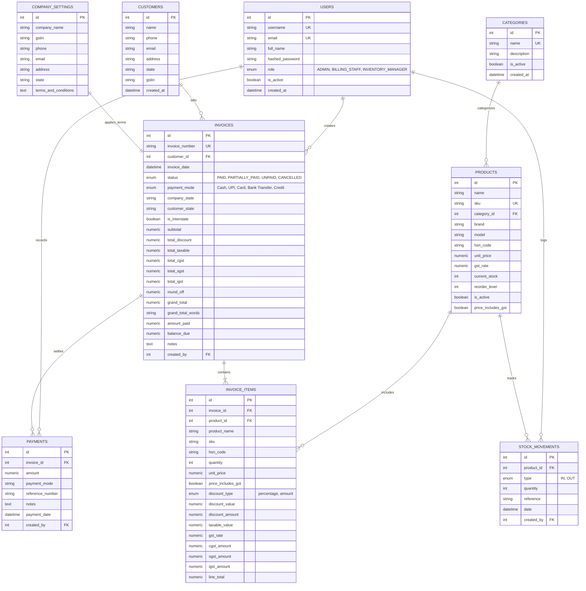

# Thangamani Agencies — Project Documentation

## 1. Executive Summary

**Thangamani Agencies** is a production-grade, full-stack **Billing and Inventory Management System** purpose-built for retail home appliance stores in India (e.g., selling LED TVs, air conditioners, refrigerators, washing machines, kitchen appliances).

The system solves two primary retail challenges:
1. **GST Compliance & Tax Invoice Generation**: Accurate automated split for Intra-state (CGST + SGST) and Inter-state (IGST) sales, support for GST-inclusive unit prices, round-off calculations, amount in words conversion (Indian numbering system), and downloadable A4 PDF tax invoices.
2. **Concurrency-Safe Inventory Control**: Real-time stock tracking with strict row-level locking (`SELECT ... FOR UPDATE`), automated stock deduction on billing, instant stock restoration upon cancellation, low-stock threshold alerting, and auditable movement logs.

---

## 2. Technology Stack

### Backend
| Component | Technology | Version / Spec |
| :--- | :--- | :--- |
| **Runtime & Language** | Python | 3.11 / 3.12 |
| **Web Framework** | FastAPI | `>=0.110.0` (Asynchronous ASGI) |
| **Server** | Uvicorn | `>=0.28.0` |
| **Database** | PostgreSQL | 14+ |
| **ORM** | SQLAlchemy | 2.0+ (Mapped typing, strict relationships) |
| **Schema Migrations** | Alembic | `>=1.13.1` |
| **Data Validation** | Pydantic v2 & `pydantic-settings` | `>=2.6.4` |
| **Authentication & Crypto**| `python-jose` (JWT) + `passlib[bcrypt]` | HS256, 480 min token expiry |
| **PDF Generation** | ReportLab | `>=4.1.0` (TrueType Rupee symbol support) |
| **Number Formatting** | `num2words` | Indian numbering format (`en_IN`) |
| **Testing** | Pytest, HTTPX | 14 automated unit & flow tests |

### Frontend
| Component | Technology | Version / Spec |
| :--- | :--- | :--- |
| **Framework** | React | 19.x with TypeScript |
| **Build Tool & Bundler** | Vite | 8.x |
| **Routing** | React Router DOM | v7 (Role-based Protected Routes) |
| **State & Auth** | React Context API | Persistent JWT in `localStorage` |
| **HTTP Client** | Axios | Request & Response interceptors |
| **Data Visualization** | Recharts | Sales trends & revenue breakdown |
| **Icons & UI** | Lucide React | Modern minimalist icons |
| **Styling** | Vanilla CSS | Custom responsive design system |

---

## 3. System Architecture & Data Flow



---

## 4. Database Schema & Entity Relationships



---

## 5. GST Engine & Calculation Rules

The business logic resides in [`backend/app/services/gst_calculator.py`](file:///d:/Thangamani%20Agencies/backend/app/services/gst_calculator.py).

### 5.1 Price Calculation Modes
1. **Price Includes GST (`price_includes_gst = True`)**:
   $$\text{Taxable Unit Price} = \frac{\text{Listed Unit Price}}{1 + \frac{\text{GST Rate}}{100}}$$
2. **Price Excludes GST (`price_includes_gst = False`)**:
   $$\text{Taxable Unit Price} = \text{Listed Unit Price}$$

### 5.2 Line Item Tax & Discounts
- **Discount Computation**:
  - Percentage: $\text{Discount} = (\text{Taxable Unit Price} \times \text{Qty}) \times \frac{\text{Discount Value}}{100}$
  - Flat Amount: $\text{Discount} = \min(\text{Discount Value}, \text{Gross Taxable})$
- **Taxable Value**:
  $$\text{Taxable Value} = (\text{Taxable Unit Price} \times \text{Qty}) - \text{Discount}$$

### 5.3 Tax Split Logic
- **Intra-State Sale** ($\text{Customer State} = \text{Company State}$, default: *Tamil Nadu*):
  $$\text{CGST Rate} = \frac{\text{GST Rate}}{2}, \quad \text{CGST Amount} = \text{Taxable Value} \times \frac{\text{CGST Rate}}{100}$$
  $$\text{SGST Rate} = \frac{\text{GST Rate}}{2}, \quad \text{SGST Amount} = \text{Taxable Value} \times \frac{\text{SGST Rate}}{100}$$
  $$\text{IGST Amount} = 0$$
- **Inter-State Sale** ($\text{Customer State} \neq \text{Company State}$):
  $$\text{CGST Amount} = 0, \quad \text{SGST Amount} = 0$$
  $$\text{IGST Amount} = \text{Taxable Value} \times \frac{\text{GST Rate}}{100}$$

### 5.4 Round-Off & Amount in Words
- Mathematical half-up round-off to the nearest rupee:
  $$\text{Round Off} = \text{round}(\text{Grand Total Unrounded}) - \text{Grand Total Unrounded}$$
- Automatic conversion to Indian Rupee denomination in words (e.g., *"Rupees Forty Thousand Three Hundred Thirty-Five Only"*).

### 5.5 Dynamic Billing Price Override & Master DB Price Sync
- **Variable Retail/Wholesale Rates**: Product unit prices and total line prices can be directly edited on the Billing POS screen.
- **Bidirectional Calculation**:
  - Editing **Rate / Unit Price**: Automatically recalculates Taxable Value, CGST, SGST (or IGST), and Line Total.
  - Editing **Total Price**: Reverse-calculates unit rate ($\text{Total} / \text{Qty}$), and extracts base Taxable Value, CGST, and SGST accurately.
- **Database Synchronization**: Upon invoice creation, `update_product_price = true` updates the master `unit_price` in the `products` table (`store.products`) so subsequent invoices and catalog searches reflect the latest selling price.

---

## 6. API Route Catalog

All API endpoints are prefixed with `/api` and secured with JWT Bearer authentication.

| Module | Method | Endpoint | Description | Required Roles |
| :--- | :--- | :--- | :--- | :--- |
| **Auth** | `POST` | `/api/auth/login` | Login and acquire JWT access token | Public |
| **Auth** | `GET` | `/api/auth/me` | Fetch authenticated user profile | All authenticated |
| **Categories** | `GET` | `/api/categories` | List active categories | All authenticated |
| **Categories** | `POST` | `/api/categories` | Create new appliance category | Admin, Inventory Manager |
| **Products** | `GET` | `/api/products` | Paginated product search & catalog | All authenticated |
| **Products** | `POST` | `/api/products` | Create product with HSN and tax rate | Admin, Inventory Manager |
| **Products** | `PUT` | `/api/products/{id}`| Update product pricing and metadata | Admin, Inventory Manager |
| **Products** | `DELETE`| `/api/products/{id}`| Soft-delete/deactivate product | Admin |
| **Inventory** | `POST` | `/api/inventory/adjust` | Record Stock IN (Restock) / OUT (Damage)| Admin, Inventory Manager |
| **Inventory** | `GET` | `/api/inventory/low-stock` | Retrieve products at or below reorder level | All authenticated |
| **Inventory** | `GET` | `/api/inventory/report` | Comprehensive stock valuation report | All authenticated |
| **Invoices** | `POST` | `/api/invoices/preview` | Live totals preview before final submission | All authenticated |
| **Invoices** | `POST` | `/api/invoices` | Generate invoice with row-level stock lock | Admin, Billing Staff |
| **Invoices** | `GET` | `/api/invoices` | Filter invoices by date, customer, status | All authenticated |
| **Invoices** | `GET` | `/api/invoices/{id}` | Detailed invoice with items and payments | All authenticated |
| **Invoices** | `GET` | `/api/invoices/{id}/pdf` | Download official A4 GST Tax Invoice PDF | All authenticated |
| **Invoices** | `POST` | `/api/invoices/{id}/cancel` | Cancel invoice and auto-restore stock | Admin, Billing Staff |
| **Payments** | `POST` | `/api/payments` | Record payment against partial/unpaid invoice | Admin, Billing Staff |
| **Dashboard** | `GET` | `/api/dashboard/metrics` | 30-day sales, low-stock count, receivables | All authenticated |
| **Settings** | `GET` | `/api/settings/company` | Retrieve company profile & terms | All authenticated |
| **Settings** | `PUT` | `/api/settings/company` | Update company address, GSTIN, and terms | Admin |

---

## 7. Role-Based Access Control (RBAC)

The system defines 3 roles with strictly enforced route guards on both backend and frontend:

| Feature / Page | Admin (`admin`) | Billing Staff (`billing_staff`) | Inventory Manager (`inventory_manager`) |
| :--- | :---: | :---: | :---: |
| **Dashboard** | Full View | View | View |
| **Billing (POS)** | Create / Cancel | Create / Cancel | Read Only |
| **Invoice History** | Full Access | Full Access | View Only |
| **Product Catalog** | Create / Edit / Delete | View Only | Create / Edit |
| **Stock Adjustments** | Full Access | View Only | Full Access |
| **Inventory Valuation**| Full Access | View Only | Full Access |
| **Company Settings** | Update Settings | View Only | View Only |

### Default Credentials:
- **Admin**: `admin` / `admin123`
- **Billing Staff**: `billing` / `billing123`
- **Inventory Manager**: `inventory` / `inventory123`

---

## 8. Directory Structure

```text
Thangamani Agencies/
├── .gitignore                      # Git ignore rules (env files, pycache, pdfs, node_modules)
├── README.md                       # Quickstart and overview
├── PROJECT.md                      # Comprehensive technical documentation (this file)
├── backend/
│   ├── .env                        # Local backend environment variables (git-ignored)
│   ├── .env.example                # Example environment file template
│   ├── alembic.ini                 # Alembic migration configuration
│   ├── requirements.txt            # Python dependencies
│   ├── verify_flow.py              # End-to-end flow test script
│   ├── alembic/
│   │   ├── env.py                  # Migration runner
│   │   └── versions/               # Schema version migrations
│   ├── app/
│   │   ├── main.py                 # FastAPI application entrypoint and middleware
│   │   ├── seed.py                 # Database seeder (categories, products, default users)
│   │   ├── api/
│   │   │   ├── deps.py             # Dependency injection (Auth, DB session, Roles)
│   │   │   └── routes/             # REST route controllers
│   │   ├── core/
│   │   │   ├── config.py           # Pydantic Settings
│   │   │   ├── db.py               # SQLAlchemy Engine & SessionLocal
│   │   │   └── security.py         # Passlib bcrypt hashing & JWT tokens
│   │   ├── models/                 # SQLAlchemy 2.0 ORM models
│   │   ├── schemas/                # Pydantic v2 validation models
│   │   ├── services/
│   │   │   ├── billing_service.py  # Concurrency-safe invoice creation & cancellation
│   │   │   ├── gst_calculator.py   # Complete GST tax mathematics & breakdown
│   │   │   ├── inventory_service.py# Row-level locked stock adjustments & reports
│   │   │   └── pdf_service.py      # ReportLab PDF invoice generator (Rupee ₹ font)
│   │   └── static/fonts/           # Unicode TrueType fonts for PDF generation
│   └── tests/
│       ├── test_billing_service.py # Unit tests for billing logic & stock locking
│       ├── test_gst_calculator.py  # Unit tests for 0%, 5%, 12%, 18%, 28% GST & rounding
│       └── test_inventory_service.py # Unit tests for IN/OUT adjustments
├── frontend/
│   ├── .env                        # Local frontend environment variables (git-ignored)
│   ├── .env.example                # Example frontend env template
│   ├── package.json                # React 19, TypeScript, Vite dependencies
│   ├── vite.config.ts              # Vite proxy configuration (/api -> backend:8000)
│   ├── index.html                  # HTML entrypoint
│   └── src/
│       ├── App.tsx                 # Router definition and route guards
│       ├── main.tsx                # React DOM root render
│       ├── api/                    # Axios API client and route functions
│       ├── components/             # Reusable UI (Sidebar, Header, Modal, Pagination)
│       ├── context/                # AuthContext (login, logout, session persistence)
│       ├── pages/                  # Views (Billing, Dashboard, Invoices, Products, etc.)
│       ├── styles/                 # Pure CSS design system
│       ├── types/                  # TypeScript interfaces and enum definitions
│       └── utils/                  # Currency formatting (₹), phone and GSTIN validators
```

---

## 9. Setup, Execution & Testing Guide

### 9.1 Local Environment Setup

1. **Activate Virtual Environment & Install Python Dependencies**:
   ```powershell
   cd "D:\Thangamani Agencies"
   .\.venv\Scripts\activate
   pip install -r backend/requirements.txt
   ```

2. **Database Migration & Seeding**:
   ```powershell
   cd backend
   alembic upgrade head
   python -m app.seed
   cd ..
   ```

3. **Install Frontend Dependencies**:
   ```powershell
   cd frontend
   npm install
   cd ..
   ```

---

### 9.2 Running the Application

- **Backend (Port 8000)**:
  ```powershell
  .\.venv\Scripts\uvicorn.exe app.main:app --app-dir backend --reload --port 8000
  ```
- **Frontend (Port 5173)**:
  ```powershell
  cd frontend
  npm run dev
  ```
  *(Or from root: `npm --prefix frontend run dev`)*

---

### 9.3 Automated Testing

Execute the test suites:
```powershell
# Run backend pytest suite (14 passed)
.\.venv\Scripts\pytest.exe backend/tests -v

# Run End-to-End lifecycle script
.\.venv\Scripts\python.exe backend/verify_flow.py

# Run frontend type-check & build verification
npm --prefix frontend run build
```

---

### 9.4 Remote Sharing / Tunneling

Because the frontend is configured with a reverse proxy in `vite.config.ts`, only port `5173` needs to be forwarded for external users to access both frontend and backend seamlessly:

```powershell
# Quick Cloudflare tunnel (no sign-up required):
.\cloudflared.exe tunnel --url http://127.0.0.1:5173

# Or via Windows OpenSSH:
ssh -R 80:127.0.0.1:5173 nokey@localhost.run
```

